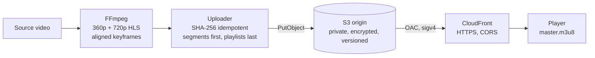

# video-ingest-pipeline

[](https://github.com/apoorvup07/video-ingest-pipeline/actions/workflows/ci.yml)

Turns a source video into adaptive-bitrate **HLS**, publishes it to a private **S3** origin, and serves it
worldwide through **CloudFront**, packaged as a container, with the infrastructure in Terraform.

> **Background.** In 2017 I built the containerised ingest step for an OTT video app: media was segmented,
> pushed to S3 with scoped permissions and played back through CloudFront. That code belonged to my employer
> (and its encoding layer was proprietary), so this repository is a clean-room rebuild of the same pipeline
> using plain FFmpeg and current AWS practice: Origin Access Control instead of OAI, idempotent uploads, and tests.

## Architecture



## How it works

| Step | What happens | Why |
|---|---|---|
| Encode | One FFmpeg run per rendition (360p @ 800 kbps, 720p @ 2.8 Mbps), H.264 `main` / 8-bit 4:2:0, AAC | Plays on practically every device |
| Keyframes | Forced every `segment_seconds` (default 6 s), scene-cut keyframes disabled | Segments line up across renditions, so the player can switch bitrate at any boundary |
| Master playlist | Lists each rendition with its peak `BANDWIDTH` (+10% headroom) | The player picks a starting rendition from this |
| Upload order | `.ts` segments first, `.m3u8` playlists last | A player never fetches a playlist that points at segments not uploaded yet |
| Idempotency | SHA-256 stored as object metadata; unchanged files are skipped | A crashed run can simply be re-run |
| Large files | 16 MiB multipart parts, 4 in parallel, adaptive retries | A failed part is retried, not the whole file |
| Caching | Segments `max-age=1 year, immutable`; playlists `max-age=60` | Segments never change; playlists are what you'd update to fix a package |

## Run it

```bash
# 1. Infrastructure (creates the bucket, CloudFront distribution and an uploader IAM policy)
cd infra && terraform init && terraform apply

# 2. Ingest a video (credentials come from your environment / role, never the image)
docker build -t video-ingest-pipeline .
docker run --rm -v "$PWD:/data" -e AWS_PROFILE -v ~/.aws:/home/ingest/.aws:ro \
  video-ingest-pipeline /data/sample.mp4 \
  --bucket "$(terraform -chdir=infra output -raw origin_bucket)" \
  --prefix titles/demo \
  --cdn-domain "$(terraform -chdir=infra output -raw cdn_domain)"
# -> playback: https://<id>.cloudfront.net/titles/demo/master.m3u8
```

Without Docker: `pip install -r requirements.txt && python -m ingest.cli sample.mp4 --bucket ... --prefix ...` (needs `ffmpeg` on PATH).

## Security

- The bucket blocks all public access; only this CloudFront distribution can read it (bucket policy pinned to the distribution ARN via `AWS:SourceArn`).
- Objects are encrypted at rest (SSE-S3) and the bucket is versioned, so an overwritten package can be recovered.
- The uploader gets a least-privilege policy: `PutObject`/`GetObject`/`AbortMultipartUpload` on objects and `ListBucket` (so a HEAD on a missing key returns 404, not 403).
- The container runs as a non-root user and holds no credentials.

## Testing

```bash
pip install -r requirements-dev.txt
pytest -q
```

- `test_segment.py` encodes a generated 8-second clip with real FFmpeg and checks every rendition gets exactly two 4-second segments.
- `test_upload.py` runs against mocked S3 (moto): correct `Content-Type` and `Cache-Control` per file type, playlists uploaded last, and re-runs skip unchanged files.

The real-encode test caught a genuine bug: FFmpeg's test source is 4:4:4, which the H.264 `main` profile rejects, so the encoder now forces `yuv420p` (which real players need anyway).

CI runs lint, the tests, `terraform validate` and a Trivy scan of the image on every push.

## Cost notes

S3 storage and CloudFront egress dominate. `PriceClass_100` limits delivery to the cheapest edge regions.
Long segment TTLs keep the cache hit ratio high, which cuts both origin requests and egress from S3.

## Trade-offs and next steps

- **Encoding runs in the container.** That's fine for short titles. For a catalogue, use AWS Elemental MediaConvert or a queue (SQS) of encode jobs on Fargate/Batch.
- **No DRM or signed URLs yet.** Next step: CloudFront signed cookies for paid content.
- **Two renditions only.** Add 1080p and an audio-only rendition; consider fMP4/CMAF segments to share one package between HLS and DASH.
- **Event-driven trigger.** S3 upload of a source file → EventBridge → ECS task.
